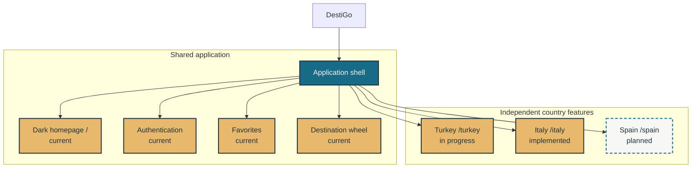
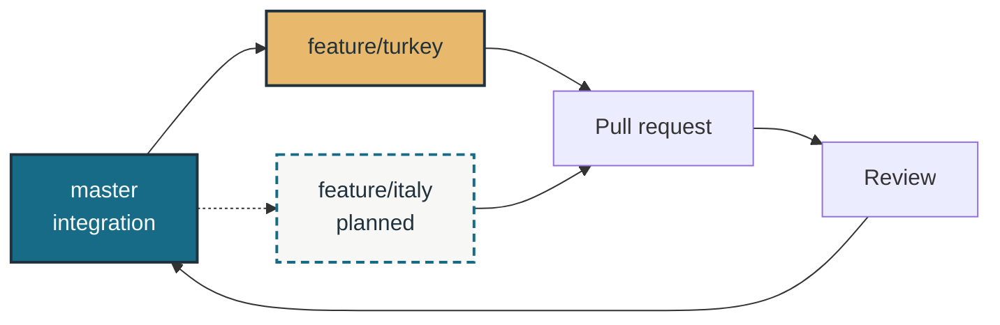

## DestiGo

**Discover destinations across Turkey, Italy, and beyond** in one interface for country guides, destination details, and saved places. Comparison across consistent portals is the core value.

This is an academic project at **SUP'COM** Higher School of Communication of Tunis. DestiGo does **not** handle bookings, payments, or travel-agency services. The MVP covers discovery, accounts, and saving.

### Demo & Links

- Conception documentation: https://www.canva.com/design/editor/shell?designId=DAHa42ltFeI&extension=KpZnYh1pxGdQTB5hnNPWgw&mode=edit

### Stack

| Layer     | Technology                                        |
| --------- | ------------------------------------------------- |
| Framework | Angular 22 with standalone components and signals |
| Language  | TypeScript 6.0                                    |
| Routing   | Angular Router with lazy-loaded country routes    |
| Rendering | Angular SSR with Express                          |
| Testing   | Vitest                                            |
| Styling   | Plain CSS, Angular Material, Tailwind CSS, Flowbite |
| Tooling   | npm 11.19.0, PowerShell, Prettier                 |

### Explore DestiGo

| Route              | Status  | Notes                                                      |
| ------------------ | ------- | ---------------------------------------------------------- |
| `/`                | Current | Dark DestiGO landing page with destination wheel           |
| `/turkey`          | Current | Türkiye portal: home, destinations, and detail pages       |
| `/italy`           | Current | Italy portal: home, destinations, experiences, and details |
| `/spain`           | Planned | Coming Soon                                                |
| `/auth/login`      | Current | Demo login                                                 |
| `/auth/register`   | Current | Demo registration                                          |
| `/favorites`       | Current | Shared favorites page                                      |
| `/about`           | Current | Project and team information                               |
| `/destinations`    | Current | Shared destination overview                                |
| `/experiences`     | Current | Shared experience overview                                 |
| `/plan-your-trip`  | Current | Shared trip-planning page                                  |

### Features Status

| Feature                     | Status  | Notes                                                        |
| --------------------------- | ------- | ------------------------------------------------------------ |
| Dark homepage (`/`)         | Current | Black/gold theme, hero imagery, animations, destination cards |
| Turkey portal (`/turkey`)   | Current | Home, destinations, experiences, about, plan-your-trip, detail |
| Italy portal (`/italy`)     | Current | Home, destinations, experiences, detail pages, favorites      |
| Spain portal (`/spain`)     | Planned | Future portal                                                |
| Destination details         | Current | Türkiye and Italy detail pages                               |
| Authentication              | Current | Demo login and registration backed by localStorage           |
| Favorites                   | Current | Shared service, reusable button, `/favorites` page           |
| About (`/about`)            | Current | Project and team information                                 |
| Destination wheel           | Current | Shared Angular/SVG country selector                          |

### Architecture

- **Isolated country features.** Each country lives under `src/app/features/<country>/` and owns its pages, components, data, and scoped CSS. Portals never import from one another.
- **Shared application concerns.** Shell, routing, authentication, favorites, and the destination wheel live outside country folders. Shared changes require coordination.
- **Lazy routing.** Country routes are loaded with `loadChildren`; shared routes handle the dashboard, auth, favorites, and about pages.
- **No backend yet.** Destination data is local. Authentication persistence, favorites storage, and any database are not finalized.

Country routes are lazy-loaded through their own route files. Each portal keeps its destination data and model local, while the shared layer only needs a route entry. That keeps country work independent and prevents one portal from breaking another.



### Getting Started

**Prerequisites:** Node.js `^22.22.3`, `^24.15.0`, or `^26.0.0`; PowerShell 5.1+; npm 11.19.0.

```bash
npm install
npm start        # http://localhost:4200 (Angular dev server)
npm run build    # production build into dist/
npm test         # Vitest unit tests
```

The build produces browser and server bundles. Tests run with Vitest through Angular's unit-test builder.

The Türkiye and Italy portals are implemented; Spain is planned. The global homepage is the dark DestiGO landing page.

### Collaboration

| Area                          | Owner           | Branch                    |
| ----------------------------- | --------------- | ------------------------- |
| Turkey portal                 | Ahmed Ben Mim   | `feature/turkey`          |
| Italy portal                  | Ons Chtioui     | `feature/italy` (planned) |
| Spain portal                  | Unassigned      | Planned                   |
| Shell, auth, favorites, wheel | Both developers | Dedicated shared branch   |

Work inside your country folder on a feature branch. Open a Pull Request, review the changes, and merge into `master`. Do not push directly to `master` or edit another developer's portal without agreement.



### Team

|             |                                                                  |
| ----------- | ---------------------------------------------------------------- |
| Institution | SUP'COM **" Higher School of Communication of Tunis                |
| Project     | Web Development                                                  |
| Supervisor  | Dr. Maroua Nouioua                                               |
| Developers  | Ahmed Ben Mim (Turkey), Ons Chtioui (Italy)                      |
| Repository  | [github.com/ons-sup/DestiGO](https://github.com/ons-sup/DestiGO) |

Academic project. Not intended for commercial use.

### Documentation

Detailed rules for contributors and AI assistants:

- [`AGENTS.md`](./AGENTS.md) — boundaries, safety, and expected behavior
- [`AI.md`](./AI.md) — architecture, data conventions, agent workflow

Do not modify application source code.