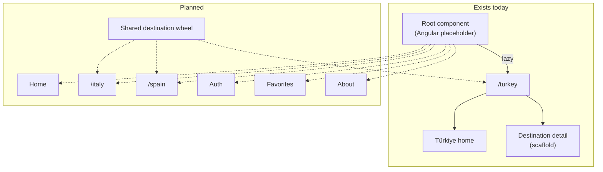

# DestiGo ✈️

**Travel Destination Explorer** — an immersive travel discovery platform built with Angular.

DestiGo helps users explore countries, discover destinations, and save the places they love. Each supported country has its own visual identity and portal. DestiGo is **not** a booking platform.

This is an academic project for **SUP'COM — Higher School of Communication of Tunis**, supervised by **Dr. Maroua Nouioua**, and developed by **Ahmed Ben Mim** and **Ons Chtioui**.

---

## Objectives

- Provide an engaging, country-based travel discovery experience.
- Keep each country portal independently developable by a single owner.
- Minimize merge conflicts through feature isolation and lazy-loaded routes.
- Build a small, maintainable MVP without unnecessary dependencies.
- Practice a professional Git and GitHub collaboration workflow.

---

## MVP Scope

| Feature             | Description                                             | Status                              |
| ------------------- | ------------------------------------------------------- | ----------------------------------- |
| Homepage            | Landing page introducing DestiGo and featured countries | Planned                             |
| Türkiye portal      | Country landing page, Istanbul, Cappadocia, Antalya     | In progress                         |
| Italy portal        | Country landing page, Rome, Venice, Florence            | Planned                             |
| Spain portal        | Country landing page and destinations                   | Planned                             |
| Destination details | Individual destination page inside a country portal     | In progress (Türkiye scaffold only) |
| Authentication      | Login and registration                                  | Planned                             |
| Favorites           | Save and manage favorite destinations                   | Planned                             |
| About page          | Project and team information                            | Planned                             |
| Shared navigation   | Navbar, footer, and application shell                   | Planned                             |
| Destination wheel   | Circular country-selection navigation                   | Planned                             |

> Status reflects the repository, not intentions. A feature is only marked complete when it is merged and verified.

---

## Countries and Portals

| Country    | Route     | Owner          | Status      |
| ---------- | --------- | -------------- | ----------- |
| 🇹🇷 Türkiye | `/turkey` | Ahmed Ben Mim  | In progress |
| 🇮🇹 Italy   | `/italy`  | Ons Chtioui    | Planned     |
| 🇪🇸 Spain   | `/spain`  | To be assigned | Planned     |

Each portal owns its own pages, components, data, models, and scoped styles. Portals must not import from one another. Shared UI belongs in `shared/` and shared infrastructure belongs in `core/`.

---

## Tech Stack

Verified from `package.json` and `angular.json`:

| Layer                 | Technology                                     | Version                              |
| --------------------- | ---------------------------------------------- | ------------------------------------ |
| Framework             | Angular (standalone components, signals, SSR)  | ^22.2.0                              |
| Language              | TypeScript                                     | ~6.0.2                               |
| Routing               | Angular Router with lazy-loaded feature routes | ^22.2.0                              |
| Reactive streams      | RxJS                                           | ~7.8.0                               |
| Server-side rendering | Angular SSR + Express                          | ^22.2.7 / ^5.1.0                     |
| Build                 | `@angular/build` application builder           | ^22.2.7                              |
| Testing               | Vitest                                         | ^5.0.0                               |
| Styling               | Plain CSS with scoped component styles         | —                                    |
| Formatting            | Prettier                                       | ^3.8.1                               |
| Package manager       | npm                                            | 11.x (`packageManager` pins 11.19.0) |

The Angular CLI for this version requires **Node.js `^22.22.3`, `^24.15.0`, or `^26.0.0`**. Check with `node -v` before installing or building.

---

## Architecture Overview

DestiGo follows a **feature-based Angular architecture**:

1. Each country is a self-contained lazy-loaded feature.
2. Shared UI is maintained separately in `shared/`.
3. Application-wide concerns (shell, global routing, auth, favorites, tokens) live in `core/` and the root app files.
4. Country portals never depend on one another.
5. Global CSS is reserved for design tokens and resets — country styling is scoped to its components.
6. Authentication and favorites are independent of country features.
7. Prefer Angular-native solutions and avoid unnecessary dependencies.



**Solid arrows = implemented. Dashed arrows = planned.**

The root app template still contains the Angular starter placeholder plus `<router-outlet />`. The shared shell, navbar, and footer have not been implemented yet.

---

## Folder Organization

### Implemented today

Only the root application files and the Türkiye feature exist. The Türkiye route is lazy-loaded from `app.routes.ts`.

```text
src/
├── app/
│   ├── app.ts / app.html / app.css
│   ├── app.config.ts
│   ├── app.config.server.ts
│   ├── app.routes.ts
│   ├── app.routes.server.ts
│   ├── app.spec.ts
│   └── features/
│       └── turkey/
│           ├── turkey.component.ts
│           ├── turkey.routes.ts
│           ├── components/
│           │   ├── destination-card/
│           │   ├── hero/
│           │   └── intro/
│           ├── data/
│           │   └── turkey.data.ts
│           ├── models/
│           │   └── destination.model.ts
│           └── pages/
│               ├── destination-detail/
│               └── turkey-home/
├── index.html
├── main.ts
├── main.server.ts
├── server.ts
└── styles.css
public/
└── favicon.ico
```

Not yet present: `core/`, `shared/`, `features/home/`, `features/italy/`, `features/spain/`, `features/auth/`, `features/favorites/`, `features/about/`, and `public/destinations/`.

### Target architecture

This is the agreed direction, not the current state. Do not create empty folders or placeholder application components just to match this tree.

```text
src/
└── app/
    ├── core/
    │   ├── layout/              # App shell, navbar, footer (planned)
    │   └── services/            # Shared services (planned)
    │
    ├── shared/
    │   ├── components/          # Reusable UI (planned)
    │   └── destination-wheel/   # Circular country selector (planned)
    │
    ├── features/
    │   ├── home/                # Planned
    │   ├── turkey/              # In progress
    │   │   ├── pages/
    │   │   ├── components/
    │   │   ├── data/
    │   │   ├── models/          # Added during implementation
    │   │   └── turkey.routes.ts
    │   ├── italy/               # Planned
    │   │   ├── pages/
    │   │   ├── components/
    │   │   ├── data/
    │   │   └── italy.routes.ts
    │   ├── spain/               # Planned
    │   ├── auth/                # Planned
    │   ├── favorites/           # Planned
    │   └── about/               # Planned
    │
    ├── app.routes.ts
    └── app.config.ts
    │
public/
└── destinations/                # Planned
    ├── turkey/
    ├── italy/
    └── spain/
```

> **Asset decision:** The target tree in the brief uses `src/assets/`. This repository's `angular.json` serves static files from `public/`, not `src/assets/`. Use `public/destinations/<country>/` unless the team deliberately adds `src/assets` to `angular.json` — that is a shared configuration change.

---

## Country Portal Ownership

### 🇹🇷 Türkiye — Ahmed Ben Mim

Primary directory: `src/app/features/turkey/`

Responsibilities:

- Türkiye landing page
- Istanbul, Cappadocia, and Antalya content
- Türkiye-specific components and styles
- Türkiye destination data and models

### 🇮🇹 Italy — Ons Chtioui

Primary directory: `src/app/features/italy/`

Responsibilities:

- Italy landing page
- Rome, Venice, and Florence content
- Italy-specific components and styles
- Italy destination data and models

### Shared application — both developers

Shared areas include the application shell, global routing, navbar and footer, the destination wheel, authentication, favorites, global design tokens, and build configuration.

Shared changes require coordination and a dedicated branch. **Do not modify another developer's country portal without agreement.** Country styles must remain scoped to their components.

---

## Local Development

### Prerequisites

- Node.js `^22.22.3`, `^24.15.0`, or `^26.0.0` (required by Angular 22)
- npm 11.x

### Install

```bash
npm install
```

### Development server

```bash
npm start
# equivalent to: ng serve
```

Open `http://localhost:4200/`. The app reloads on source changes.

### Build and tests

```bash
npm run build        # production build into dist/
npm run watch        # development watch build
npm test             # Vitest unit tests via the Angular unit-test builder
```

There is no lint script configured. Prettier is installed and configured in `.prettierrc`; check formatting with `npx prettier --check <files>`.

### Server-side rendering

```bash
npm run build
npm run serve:ssr:DestiGO
```

All routes currently use `RenderMode.Prerender` via `src/app/app.routes.server.ts`.

---

## Git Collaboration Workflow

> **Branch naming note:** The GitHub repository currently uses `master` as its default branch. This guide targets `main` as the stable branch. Either rename the default branch once (team decision) or replace `main` with `master` in the commands below.

### Branch plan

| Branch                      | Purpose                 | Owner |
| --------------------------- | ----------------------- | ----- |
| `main`                      | Stable, integrated code | Both  |
| `feature/turkey`            | Türkiye portal          | Ahmed |
| `feature/italy`             | Italy portal            | Ons   |
| `feature/destination-wheel` | Shared wheel component  | Both  |
| `feature/auth`              | Authentication          | Both  |
| `feature/favorites`         | Favorites               | Both  |

The shared Angular architecture and initial route placeholders should be merged into `main` before country development continues.

### Initial setup

Each developer branches from the latest `main`:

```bash
git switch main
git pull --ff-only origin main
git switch -c feature/italy
```

### Daily development

Work only inside your assigned feature directory. Inspect changes before committing:

```bash
git status
git diff
```

Stage only the intended files:

```bash
git add src/app/features/italy/
git commit -m "feat(italy): add destination cards"
git push -u origin feature/italy
```

After upstream tracking is configured, `git push` is enough.

### Pull requests

1. Push the feature branch.
2. Open a Pull Request targeting `main`.
3. Review the changed files.
4. Run available checks (`npm run build`, `npm test`).
5. Resolve issues before merging.
6. Merge only when the feature is ready.

### Safety rules

- Never push directly to `main`.
- Never force-push shared branches.
- Never commit `node_modules` or `dist/`.
- Never commit credentials, `.env` files, or secrets.
- Avoid `git add .` when unrelated files are modified.
- Never run destructive commands without understanding them.
- Never discard a teammate's uncommitted changes.
- Ask for help when a merge conflict occurs.

### Beginner troubleshooting

| Problem                              | Safe response                                                                               |
| ------------------------------------ | ------------------------------------------------------------------------------------------- |
| `git status` shows unexpected files  | Read the output; stage only files you intentionally changed.                                |
| You started work on the wrong branch | Do not discard work. Ask for help before switching or stashing.                             |
| `git push` is rejected               | Run `git pull --ff-only`, resolve locally, then push. Never force-push.                     |
| Merge conflict                       | Stop. Open the conflicted files, understand both sides, and ask a teammate if unsure.       |
| Accidentally staged `node_modules`   | `git restore --staged node_modules` (the folder stays on disk).                             |
| Need to undo an unpushed commit      | `git reset --soft HEAD~1` keeps changes staged. Do not use `--hard` unless you are certain. |
| You are in a detached HEAD state     | Do not commit. Ask for help to create a branch or return to your feature branch.            |

---

## Destination Wheel (Planned)

DestiGo will include a circular destination-selection wheel inspired by the interactive portal navigation concept on Brittany Chiang's website.

**Concept:** a compass-like button opens a circular overlay with selectable country sectors.

| Requirement   | Detail                                                                      |
| ------------- | --------------------------------------------------------------------------- |
| Destinations  | Türkiye → `/turkey`, Italy → `/italy`, Spain → `/spain`                     |
| Visuals       | Circular SVG sectors, country names and flags                               |
| Interaction   | Click/tap selection, optional press-and-release, active-sector highlighting |
| Motion        | Smooth open/close animations                                                |
| Accessibility | Keyboard navigation, Escape to close, accessible labels                     |
| Layout        | Responsive                                                                  |

Implementation constraints:

- Angular components, Router, signals, SVG, and CSS animations.
- Angular CDK Overlay only if justified.
- **No React, Next.js, React hooks, or Radix React Dialog.**
- One independent shared component in `shared/destination-wheel/`. Country portals must not duplicate it.

The wheel will be built **after** country routes and initial portal pages are functional. Until then, normal Angular navigation is sufficient.

---

## Development Roadmap

| Milestone | Scope                                                                        | Status      |
| --------- | ---------------------------------------------------------------------------- | ----------- |
| M0        | Angular scaffold, SSR, Vitest, Prettier                                      | Complete    |
| M1        | Shared shell, navbar/footer, route placeholders, merge shared base to `main` | Planned     |
| M2        | Türkiye portal (landing, Istanbul, Cappadocia, Antalya, details)             | In progress |
| M3        | Italy portal (landing, Rome, Venice, Florence, details)                      | Planned     |
| M4        | Authentication and favorites                                                 | Planned     |
| M5        | Destination wheel integrated into the shell                                  | Planned     |
| M6        | About page, responsive polish, accessibility, tests                          | Planned     |
| M7        | Spain portal                                                                 | Planned     |

---

## Team and Academic Information

| Role         | Name / Institution                                               |
| ------------ | ---------------------------------------------------------------- |
| Institution  | SUP'COM — Higher School of Communication of Tunis                |
| Course       | Web Development                                                  |
| Supervisor   | Dr. Maroua Nouioua                                               |
| Team members | Ahmed Ben Mim, Ons Chtioui                                       |
| Repository   | [github.com/ons-sup/DestiGO](https://github.com/ons-sup/DestiGO) |

---

## Documentation

- [`AGENTS.md`](./AGENTS.md) — authoritative rules for OpenCode and other AI coding assistants.
- [`AI.md`](./AI.md) — short human guide for using AI assistants safely on this project.

## License

Academic project for the Web Development course at SUP'COM. Not intended for commercial use.
