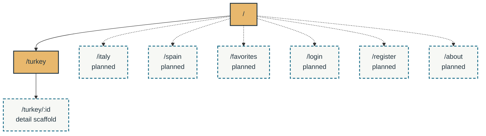
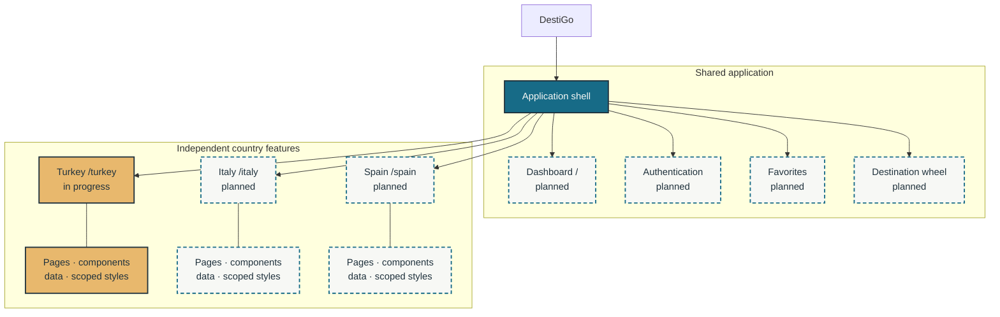
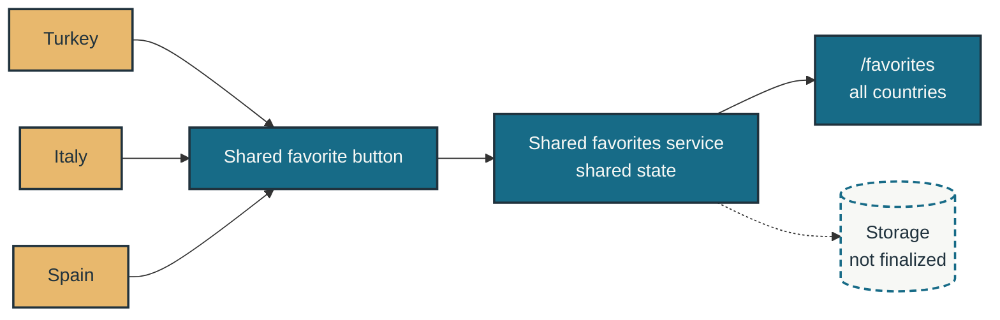
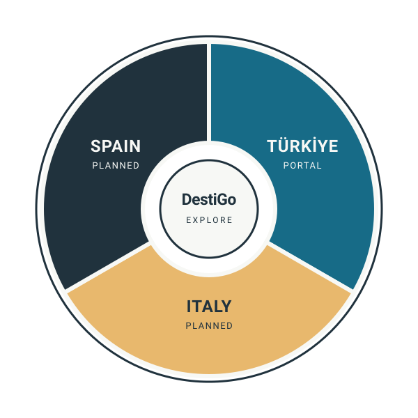
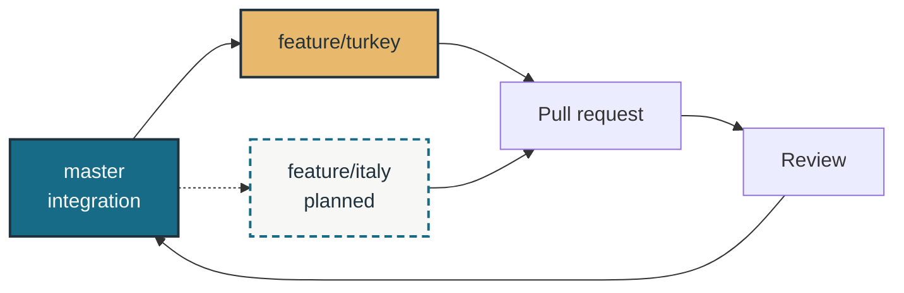

# DestiGo

**Discover destinations across Turkey, Italy, and beyond — in one place.**


DestiGo is a travel discovery platform for students, young adults, couples, groups of friends, and occasional travelers. It replaces scattered destination research with one interface for country guides, destination details, and saved places. The value is comparison: consistent country portals, comparable destination pages, and one favorites list across every portal.

This is an academic project at **SUP'COM — Higher School of Communication of Tunis**. DestiGo does **not** handle bookings, payments, or travel-agency services. The MVP covers discovery, accounts, and saving; search, maps, and recommendations are out of scope for this version.

## Stack

| Layer     | Technology                                        |
| --------- | ------------------------------------------------- |
| Framework | Angular 22 with standalone components and signals |
| Language  | TypeScript 6.0                                    |
| Routing   | Angular Router with lazy-loaded country routes    |
| Rendering | Angular SSR with Express                          |
| Testing   | Vitest                                            |
| Styling   | Plain CSS, scoped per component                   |
| Tooling   | npm 11.19.0, Prettier                             |

## Explore DestiGo



> Solid routes exist on `feature/turkey`; dashed routes are planned. On that branch, `/` redirects to `/turkey`. The dashboard will replace the redirect once it exists.

## Features

| Feature                   | Status      | Notes                                                                         |
| ------------------------- | ----------- | ----------------------------------------------------------------------------- |
| Dashboard (`/`)           | Planned     | Guests discover countries; signed-in users get personal content and favorites |
| Turkey portal (`/turkey`) | In progress | Home page, three destinations, detail-page scaffold                           |
| Italy portal (`/italy`)   | Planned     | Rome, Venice, Florence                                                        |
| Spain portal (`/spain`)   | Planned     | Future portal                                                                 |
| Destination details       | In progress | Turkey route scaffold only                                                    |
| Authentication            | Planned     | Shared login and registration                                                 |
| Favorites                 | Planned     | Shared service, reusable button, `/favorites` page                            |
| About (`/about`)          | Planned     | Project and team information                                                  |
| Destination wheel         | Planned     | Shared Angular/SVG country selector                                           |

Status reflects the `feature/turkey` branch; planned items are not implemented.

## Architecture

- **Isolated country features.** Each country lives under `src/app/features/<country>/` and owns its pages, components, data, models, and scoped CSS. Portals never import from one another.
- **Shared application concerns.** Shell, routing, authentication, favorites, and the destination wheel live outside country folders. Shared changes require coordination.
- **Lazy routing.** Country routes are loaded with `loadChildren`; shared routes will handle the dashboard, auth, favorites, and about pages.
- **No backend yet.** Destination data is local. Authentication persistence, favorites storage, and any database are not finalized.

Country routes are lazy-loaded through their own route files. Each portal keeps its destination data and model local, while the shared layer only needs a route entry. That keeps country work independent and prevents one portal from breaking another. On `feature/turkey`, the detail route is a scaffold: it exists, but its destination input is not wired yet.



### Dashboard

The homepage will adapt to the visitor. Guests will discover available countries and reach login or registration. Authenticated users will see personalized content, saved destinations, and account navigation. Authentication and favorites are shared concerns, not country-specific features.

### Centralized favorites

Favorites are not implemented per country. Country portals will render one reusable favorite button connected to a shared service; `/favorites` will collect saved destinations from every portal. Storage will sit behind that service once the persistence approach is chosen.



All favorites functionality is planned.

## Destination wheel

The wheel is a planned shared navigation component for switching between country portals. It will use Angular, SVG, and CSS, support mouse, touch, and keyboard input, and remain independent of country-specific code. It should be built after the country routes are stable.



The original brief asks for a modern, minimal, responsive travel interface. The wheel artwork follows that direction, while application styling stays scoped per component rather than in global CSS.

Artwork palette: ocean blue `#176B87`, sand `#E8B86D`, off-white `#F7F8F5`, dark slate `#20323D`.

## Getting started

**Prerequisites:** Node.js `^22.22.3`, `^24.15.0`, or `^26.0.0`; npm 11.19.0.

```bash
npm install
npm start        # http://localhost:4200
npm run build    # production build into dist/
npm test         # Vitest
```

The build produces browser and server bundles. Tests run with Vitest through Angular's unit-test builder. Turkey is under active development on `feature/turkey`; its detail route is still a scaffold.

## Collaboration

| Area                          | Owner           | Branch                    |
| ----------------------------- | --------------- | ------------------------- |
| Turkey portal                 | Ahmed Ben Mim   | `feature/turkey`          |
| Italy portal                  | Ons Chtioui     | `feature/italy` (planned) |
| Spain portal                  | Unassigned      | Planned                   |
| Shell, auth, favorites, wheel | Both developers | Dedicated shared branch   |

Work inside your country folder on a feature branch. Open a Pull Request, review the changes, and merge into `master`. Do not push directly to `master` or edit another developer's portal without agreement.



Detailed rules for contributors and AI assistants: [`AGENTS.md`](./AGENTS.md) and [`AI.md`](./AI.md).

## Team

|             |                                                                  |
| ----------- | ---------------------------------------------------------------- |
| Institution | SUP'COM — Higher School of Communication of Tunis                |
| Project     | Web Development                                                  |
| Supervisor  | Dr. Maroua Nouioua                                               |
| Developers  | Ahmed Ben Mim (Turkey), Ons Chtioui (Italy)                      |
| Repository  | [github.com/ons-sup/DestiGO](https://github.com/ons-sup/DestiGO) |

Academic project. Not intended for commercial use.
